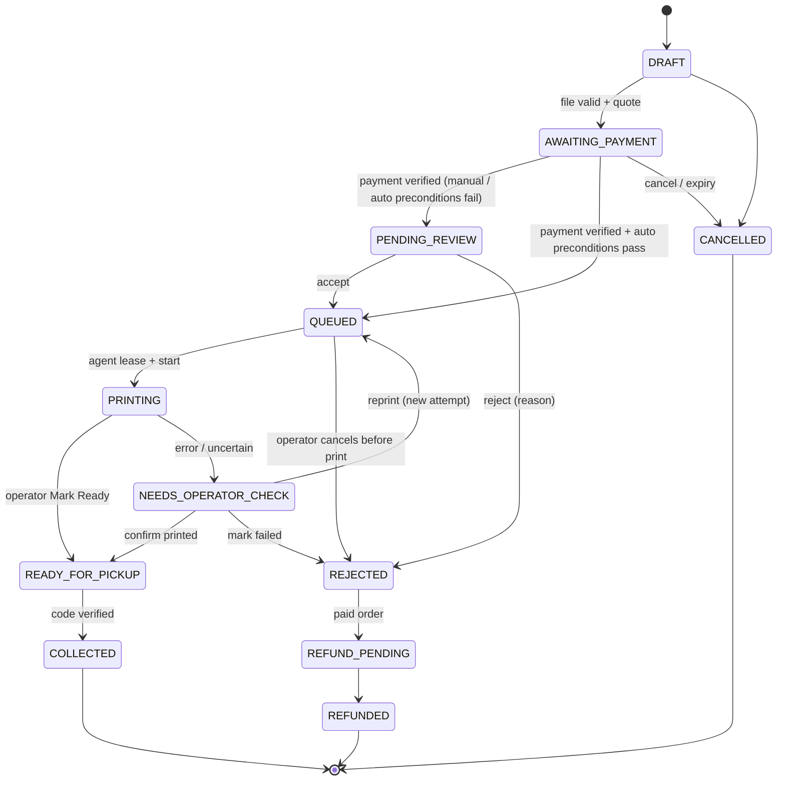
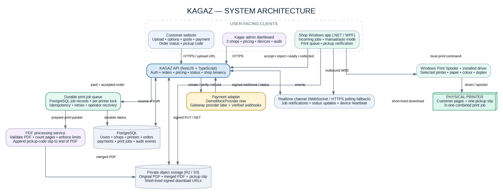

# Kagaz — Product Requirements Document (PRD)

| Field          | Value                                                                                                                |
| -------------- | -------------------------------------------------------------------------------------------------------------------- |
| Product        | Kagaz — web-to-printer print-order orchestration platform                                                            |
| Document       | Product Requirements Document                                                                                        |
| Version        | 1.0 (derived from _Investor Prototype Architecture & Execution Plan v1.0_, 5 Nov 2026)                               |
| Owner          | Kagaz team                                                                                                           |
| Release target | Investor-ready working prototype (not a public launch)                                                               |
| Geography      | Mandya, Karnataka, India                                                                                             |
| Related docs   | [IMPLEMENTATION_PLAN.md](IMPLEMENTATION_PLAN.md), [../CLAUDE.md](../CLAUDE.md), [architecture.png](architecture.png) |

> **Scope clarification.** This PRD defines an investor-ready working prototype. Real payment collection, settlement onboarding, security hardening and production support must be completed before accepting public customer payments. Every requirement below that mentions "live" payment is designed-for but **not activated** in this release.

---

## Table of contents

1. [Product summary](#1-product-summary)
2. [Problem and opportunity](#2-problem-and-opportunity)
3. [Goals, non-goals and success metrics](#3-goals-non-goals-and-success-metrics)
4. [Users and personas](#4-users-and-personas)
5. [Product surfaces](#5-product-surfaces)
6. [Key user journeys](#6-key-user-journeys)
7. [Functional requirements](#7-functional-requirements)
8. [Business rules](#8-business-rules)
9. [Order, payment and print-job state models](#9-order-payment-and-print-job-state-models)
10. [Data model](#10-data-model)
11. [API contract](#11-api-contract)
12. [Realtime events](#12-realtime-events)
13. [Non-functional requirements](#13-non-functional-requirements)
14. [Security, privacy and compliance](#14-security-privacy-and-compliance)
15. [Architecture overview](#15-architecture-overview)
16. [Acceptance tests](#16-acceptance-tests)
17. [Release / exit criteria](#17-release--exit-criteria)
18. [Investor demo script](#18-investor-demo-script)
19. [Risks](#19-risks)
20. [Open decisions and working defaults](#20-open-decisions-and-working-defaults)
21. [Out of scope / future roadmap](#21-out-of-scope--future-roadmap)
22. [Glossary](#22-glossary)
23. [References](#23-references)

---

## 1. Product summary

Kagaz is a smart print-management platform that connects customers (primarily students) who need documents printed with local print shops. Customers use a **responsive website** to upload a PDF, choose print options, see a server-calculated price, pay, and track their order. Shop operators use a **Windows desktop application** connected to their existing printers to receive, approve, print and hand over jobs. A **cloud backend** coordinates document storage, pricing, payments, job dispatch, printer status and **pickup-code verification**. A **Kagaz admin dashboard** configures shops and oversees the system.

**Product definition:** Kagaz is a _multi-shop print-order orchestration platform_. It is **not** a kiosk, a printer driver, or merely a WhatsApp bot. Its value is the workflow connecting **customer checkout** to a **verified physical handover**.

### 1.1 Prototype configuration

| Configuration        | Decision                                                              |
| -------------------- | --------------------------------------------------------------------- |
| Initial geography    | Mandya, Karnataka                                                     |
| Shop setup           | 3 shop tenants / 3 independent shop queues                            |
| Development horizon  | 30 days (engineering plan, not a public market pilot)                 |
| Demo workload target | 100–200 controlled orders / test transactions                         |
| Immediate milestone  | Next-day end-to-end demonstration using a real PDF and a real printer |
| Payment in demo      | Mock provider auto-approves; clearly marked as simulated              |

### 1.2 Confirmed build assumptions

1. Customer interface is a responsive website. **WhatsApp is excluded** from the first build.
2. Customer **manually selects** one of the available Mandya print shops. Automatic nearest-shop routing is a later enhancement.
3. The selected shop receives the order in its Windows application.
4. Each shop can be configured for **Manual Approval** or **Auto-accept / Auto-print**. The mode is controlled per shop and can be paused by the operator.
5. The customer **pays before** the job is released to the print queue. In demo mode, a mock provider marks payment successful without moving money.
6. The document and the pickup-code slip are combined into **one PDF** and submitted as **one print job**.
7. The customer sees order status and the pickup code on the website. The operator verifies the code before marking the order collected.
8. The software is designed for three independent shop tenants and 100–200 controlled demo/test orders. The prototype is not marketed publicly.

### 1.3 What "sellable" means for this release

A credible end-to-end product experience with **real printer output**, clear operational controls, **recoverable failures**, a proper architecture, and a **payment integration boundary**. It does **not** mean the mock-payment build is production-ready. A live release additionally requires gateway approval, merchant settlement design, operational support, privacy/security review and printer compatibility testing.

---

## 2. Problem and opportunity

**Customer pain (students and walk-in customers):**

- Must physically carry files (USB, email to the shop, WhatsApp) and wait in queue while the operator opens, configures and prints each file.
- Price is opaque and inconsistent; disputes about pages/copies/colour are common.
- Sharing personal documents with shop staff through personal messaging apps is a privacy risk.
- No visibility into when a print is ready.

**Shop pain:**

- Peak-hour rush (exam season, assignment deadlines) creates long queues and manual errors (wrong copies, wrong colour, mixed-up stacks).
- Payment collection and reconciliation are manual.
- No structured record of who printed what, when, and who collected it.

**Kagaz solution:** the customer prepares and pays for the job remotely; the shop receives a fully specified, prepaid, ready-to-print packet with a unique pickup slip; the customer collects with a one-time code. Every step is auditable.

---

## 3. Goals, non-goals and success metrics

### 3.1 Goals (this release)

| ID  | Goal                                                                                                                                                                  |
| --- | --------------------------------------------------------------------------------------------------------------------------------------------------------------------- |
| G1  | Demonstrate a complete, physical transaction: one real PDF in → one mock-paid order → one combined PDF-plus-slip print job → website status update → verified pickup. |
| G2  | Operate three isolated shop tenants with independent queues, pricing, devices and printers.                                                                           |
| G3  | Support Manual Approval and guarded Auto-accept/Auto-print modes per shop.                                                                                            |
| G4  | Provide a provider-independent payment boundary with a clearly-labelled mock provider, ready for a live gateway adapter.                                              |
| G5  | Guarantee no duplicate prints, no lost orders and no cross-tenant access across 100–200 controlled test orders.                                                       |
| G6  | Make failures recoverable and visible (printer offline, paper out, agent restart, ambiguous print outcome).                                                           |

### 3.2 Non-goals (this release)

- Accepting real customer money / live settlement.
- Public marketing or a public market pilot.
- WhatsApp ordering, native mobile apps.
- Automatic nearest-shop routing.
- Document formats other than PDF; paper sizes other than A4.
- Microservices, Kubernetes, Redis/BullMQ, AI features, custom printer drivers.
- Physical print-completion detection via hardware sensors.

### 3.3 Success metrics (prototype)

| Metric                                                  | Target                                                                                  |
| ------------------------------------------------------- | --------------------------------------------------------------------------------------- |
| End-to-end demo success                                 | 100% of rehearsal runs complete browser → print → pickup without developer intervention |
| Demo duration                                           | Full script fits in 2–3 minutes                                                         |
| Controlled order volume                                 | 100–200 orders across 3 shops processed                                                 |
| Lost orders                                             | 0                                                                                       |
| Duplicate physical prints caused by the system          | 0                                                                                       |
| Cross-tenant data exposure                              | 0 (verified by automated tests)                                                         |
| Duplicate paid-order transitions from repeated webhooks | 0                                                                                       |
| Time from "Pay" to job visible in Windows app           | p95 ≤ 3 s with WebSocket; ≤ polling interval (≤ 10 s) on fallback                       |
| Price mismatches (server vs. displayed)                 | 0                                                                                       |

---

## 4. Users and personas

| Persona                      | Description                                                                                            | Primary needs                                                                                                |
| ---------------------------- | ------------------------------------------------------------------------------------------------------ | ------------------------------------------------------------------------------------------------------------ |
| **Customer (Student)**       | College/school student in Mandya with a PDF to print (assignment, notes, forms). Uses a phone browser. | Fast upload, clear price before paying, know when it's ready, quick collection, privacy of documents.        |
| **Shop Owner**               | Owns one print shop. May also operate it.                                                              | Configure pricing and approval mode, see the queue, trust payments, avoid waste and disputes.                |
| **Shop Operator**            | Staff member at the shop counter running the Windows app.                                              | See incoming jobs, accept/reject quickly, print reliably, verify pickup, recover from printer problems.      |
| **Kagaz Admin**              | Kagaz team member operating the platform.                                                              | Onboard shops/printers/devices, set modes, monitor health, search orders, read audit log, run demo controls. |
| **Investor (demo audience)** | Watches the live demo.                                                                                 | See a real, credible, honest end-to-end product and a scalable architecture.                                 |

### 4.1 Roles and permissions

| Role                        | Scope           | Permissions                                                                                                                                           |
| --------------------------- | --------------- | ----------------------------------------------------------------------------------------------------------------------------------------------------- |
| `CUSTOMER`                  | Own orders only | Create orders, upload, pay, view own order status and pickup code, cancel before payment.                                                             |
| `SHOP_OPERATOR`             | One shop        | View shop jobs, accept/reject, print, mark ready, verify pickup, resolve operator checks, pause auto mode.                                            |
| `SHOP_OWNER`                | One shop        | All operator permissions + edit shop pricing, opening hours, approval mode, view shop reports and staff.                                              |
| `ADMIN`                     | Platform        | Manage all shops, printers, devices, enrollment codes, pricing, modes, demo controls; read audit logs; search all orders.                             |
| `DEVICE` (machine identity) | One shop device | Authenticated Windows agent: fetch jobs, lease printers, report status/heartbeat. Human actions on a device are attributed to the logged-in operator. |

---

## 5. Product surfaces

| Surface                                                                  | Primary responsibility                                                          | MVP screens                                                                                                                   |
| ------------------------------------------------------------------------ | ------------------------------------------------------------------------------- | ----------------------------------------------------------------------------------------------------------------------------- |
| **Customer website** (Next.js, responsive)                               | Order creation, document upload, print options, price, payment and status.      | Shop selection; upload; print settings; checkout; order tracking; pickup code.                                                |
| **Shop Windows app** (.NET / WPF)                                        | Receive, approve, print and hand over paid jobs. Connect local printer drivers. | Login / device pairing; pending jobs; job detail; accept/reject; print; mark ready; pickup-code verification; printer status. |
| **Kagaz admin dashboard** (same Next.js codebase, role-protected routes) | Configure shops and oversee the system.                                         | Shop list; shop/printer setup; pricing; mode; online/offline state; order search; audit log; demo controls.                   |

---

## 6. Key user journeys

### 6.1 Customer: place and pay for an order

1. Customer opens the Kagaz website and sees the list of Mandya shops with open/closed state, rates, and capabilities (B/W, colour, duplex).
2. Customer selects a shop. If the shop is closed or paused, it is shown as unavailable and cannot be selected for checkout.
3. Customer identifies themselves (v1 default: phone number + OTP; demo: OTP delivered through a demo channel — see §20).
4. Customer uploads a PDF. The browser receives a short-lived signed upload URL and uploads **directly** to private storage.
5. Backend validates the file by content (magic bytes, parseability, encryption, page count, size limits). Errors are shown clearly; invalid files cannot proceed.
6. Customer chooses page range, copies, B/W or colour, single- or double-sided, paper size (A4 only). The server returns a quote with a line-item breakdown.
7. Customer clicks **Pay**. Backend creates a payment for the **server-calculated** amount using a **price snapshot**.
8. Demo: the mock provider approves; the UI clearly shows **"DEMO PAYMENT — NO MONEY CHARGED"**.
9. Customer lands on the order tracking page, which updates in realtime: _Paid → Waiting for shop → Queued → Printing → Ready for pickup_.

### 6.2 Operator: manual approval and print

1. Paid order appears in the Windows app's **Pending** list with a notification sound.
2. Operator opens job detail: file preview (first pages), page count, page range, copies, colour, duplex, price, customer short reference (no full phone number).
3. Operator clicks **Accept** (job enters the printer queue) or **Reject** with a mandatory reason (triggers a refund workflow — simulated in demo).
4. The agent prints jobs one at a time per printer: downloads the combined packet, verifies its SHA-256 checksum, applies settings, submits **one** spooler job.
5. Operator checks the physical stack (customer pages followed by the pickup slip) and clicks **Mark Ready**.
6. Customer website shows **READY FOR PICKUP** and the pickup code.

### 6.3 Operator: auto mode

1. Shop has Auto-accept/Auto-print enabled and not paused.
2. A paid order is auto-accepted **only if** all preconditions pass (§8.4). Otherwise it is routed to manual review with the failing reason shown.
3. Operator can pause auto mode instantly from the Windows app; the pause is reflected server-side immediately.

### 6.4 Pickup

1. Customer arrives and tells the operator the 8-character code (or shows it on their phone).
2. Operator types the code in the Windows app's **Verify Pickup** screen.
3. Backend verifies the code (shop-scoped, rate-limited), marks it consumed and moves the order to **COLLECTED**.
4. A second use of the same code is rejected and logged.

### 6.5 Failure / recovery journeys

| Situation                                | Expected behaviour                                                                                                                                                                             |
| ---------------------------------------- | ---------------------------------------------------------------------------------------------------------------------------------------------------------------------------------------------- |
| Printer offline / paper out              | Agent reports issue; job held; order not shown READY; operator sees banner and can Resume after fixing.                                                                                        |
| Agent disconnects / PC restarts mid-job  | Agent reconnects, fetches outstanding jobs via REST, reconciles with spooler; **never** auto-resubmits an attempt. Ambiguous jobs → `NEEDS_OPERATOR_CHECK`.                                    |
| Ambiguous print outcome                  | Order moves to `NEEDS_OPERATOR_CHECK`; operator chooses **Confirm printed (Mark Ready)**, **Reprint with confirmation** (new attempt, warning, audited), or **Mark failed** (reject + refund). |
| Operator rejects a paid order            | Reason recorded; refund record created (mock: "Demo refund — no money moved"); customer sees Rejected + refund state.                                                                          |
| Shop paused/closed after a customer paid | Order stays in `PENDING_REVIEW`; admin/owner must explicitly accept later or reject (refund).                                                                                                  |

---

## 7. Functional requirements

Priority: **P0** = required for the Day 0–1 vertical-slice demo; **P1** = required for the 30-day prototype exit; **P2** = designed-for, may be deferred.

### 7.1 Customer website (FR-CUST)

| ID         | Requirement                                                                                                                                                                      | Priority                                 |
| ---------- | -------------------------------------------------------------------------------------------------------------------------------------------------------------------------------- | ---------------------------------------- |
| FR-CUST-01 | Show list of active shops with name, address, open/closed/paused status, B/W and colour rates, duplex availability. Demo shops display a "DEMO" tag.                             | P0                                       |
| FR-CUST-02 | Prevent checkout for closed, paused or maintenance shops; show "Currently unavailable".                                                                                          | P1                                       |
| FR-CUST-03 | Customer identity: phone number + OTP (demo OTP channel in demo env). Order tracking accessible via authenticated session **or** an unguessable tracking link.                   | P0 (guest + tracking link) / P1 (OTP)    |
| FR-CUST-04 | Upload a single PDF via signed direct-to-storage upload with progress indicator. Max file size and page limits enforced server-side and shown to user.                           | P0                                       |
| FR-CUST-05 | Display validation errors in plain language: not a PDF, password-protected, corrupt/unreadable, too large, too many pages.                                                       | P0                                       |
| FR-CUST-06 | Print options: page range (e.g. `1-3,5,8-10`; default all), copies (1–N), B/W or colour (only if shop supports), single/double-sided (only if supported), paper size A4 (fixed). | P0 (copies, colour) / P1 (range, duplex) |
| FR-CUST-07 | Show server quote with breakdown: selected pages, copies, printed sides, rate, subtotal, minimum-charge adjustment, total in ₹. Re-quote on every option change.                 | P0                                       |
| FR-CUST-08 | Pay button creates payment for the server amount only; the client never sends an amount.                                                                                         | P0                                       |
| FR-CUST-09 | Persistent **DEMO PAYMENT — NO MONEY CHARGED** banner on every page in demo environment; payment confirmation screen repeats it.                                                 | P0                                       |
| FR-CUST-10 | Order tracking page with status timeline, updated in realtime (WebSocket) with polling fallback.                                                                                 | P0 (polling) / P1 (WebSocket)            |
| FR-CUST-11 | Pickup code shown **only** when order is `READY_FOR_PICKUP`; large, monospace, copy-able; hidden again after `COLLECTED`.                                                        | P0                                       |
| FR-CUST-12 | Customer can cancel an order before payment. After payment, cancellation requires the shop/admin (refund flow).                                                                  | P1                                       |
| FR-CUST-13 | "My orders" list for an identified customer.                                                                                                                                     | P2                                       |
| FR-CUST-14 | Show rejection reason and refund status ("Demo refund — no money moved" in demo).                                                                                                | P1                                       |
| FR-CUST-15 | Display retention notice: files are deleted automatically after collection/expiry (see §14.3).                                                                                   | P1                                       |

### 7.2 Shop Windows app (FR-SHOP)

| ID         | Requirement                                                                                                                                                                                               | Priority                      |
| ---------- | --------------------------------------------------------------------------------------------------------------------------------------------------------------------------------------------------------- | ----------------------------- |
| FR-SHOP-01 | First-run **device pairing** using a one-time enrollment code generated in the admin dashboard. Device token stored encrypted locally (Windows DPAPI).                                                    | P0                            |
| FR-SHOP-02 | Operator login (staff account) on a paired device so actions are attributed to a person.                                                                                                                  | P1                            |
| FR-SHOP-03 | Discover locally installed Windows printers; operator maps one or more to the shop and confirms capabilities (colour, duplex, A4) during setup; capabilities reported to backend.                         | P0 (single printer) / P1      |
| FR-SHOP-04 | Maintain an outbound-only connection (HTTPS + WebSocket). No inbound ports. Reconnect automatically with backoff.                                                                                         | P0                            |
| FR-SHOP-05 | Job lists: **Pending review**, **Queue**, **Printing**, **Needs check**, **Ready**, **Recent collected**. New-job toast + sound.                                                                          | P0 (pending/ready) / P1 (all) |
| FR-SHOP-06 | Job detail: preview of first pages, page count, range, copies, colour, duplex, price, public order ref, created time. No full customer phone number.                                                      | P0                            |
| FR-SHOP-07 | Accept / Reject (mandatory reason from list + free text).                                                                                                                                                 | P0                            |
| FR-SHOP-08 | Mode switch: Manual / Auto; **Pause auto** toggle visible at all times.                                                                                                                                   | P1                            |
| FR-SHOP-09 | Per-printer local queue; never two Kagaz jobs simultaneously on one physical printer; obtain server lease before starting.                                                                                | P0 (sequential) / P1 (lease)  |
| FR-SHOP-10 | Download packet via short-lived signed URL, verify SHA-256, set driver copy count = 1, apply colour/duplex/A4 settings, submit via Windows print spooler as one job named `KAGAZ-<publicRef>-A<attempt>`. | P0                            |
| FR-SHOP-11 | Report print progress and spooler job ID; surface spooler states (spooling, printing, offline, paper out, error).                                                                                         | P1                            |
| FR-SHOP-12 | **Mark Ready** button enabled only after the job left the print step; requires operator confirmation ("I have checked the stack and slip").                                                               | P0                            |
| FR-SHOP-13 | **Verify Pickup** screen: enter code → shows order summary for confirmation → marks COLLECTED. Clear error for invalid/used/locked-out codes.                                                             | P0                            |
| FR-SHOP-14 | Needs-check resolution: **Confirm printed**, **Reprint with confirmation** (warns about duplicates, creates new attempt), **Mark failed**. All audited.                                                   | P1                            |
| FR-SHOP-15 | Printer status panel: online/offline, last error, queue depth per printer.                                                                                                                                | P1                            |
| FR-SHOP-16 | Heartbeat every 15 s with app version, printer statuses, queue depth.                                                                                                                                     | P1                            |
| FR-SHOP-17 | Auto-start with Windows (optional setting); single instance.                                                                                                                                              | P2                            |
| FR-SHOP-18 | Installer and update mechanism; signed binaries when a certificate is available.                                                                                                                          | P1 (installer) / P2 (signing) |

### 7.3 Admin dashboard (FR-ADMIN)

| ID          | Requirement                                                                                                                                            | Priority          |
| ----------- | ------------------------------------------------------------------------------------------------------------------------------------------------------ | ----------------- |
| FR-ADMIN-01 | Admin login (staff account with `ADMIN` role).                                                                                                         | P0 (seeded admin) |
| FR-ADMIN-02 | Shop list with status, mode, paused flag, device online/offline, printer health, queue depth, today's orders.                                          | P1                |
| FR-ADMIN-03 | Create/edit shop: name, address, contact, opening hours, status (OPEN/CLOSED/MAINTENANCE), approval mode, auto-mode limits, demo flag.                 | P1                |
| FR-ADMIN-04 | Generate one-time device enrollment codes per shop (expiry 30 min); list/revoke devices.                                                               | P0 (seeded) / P1  |
| FR-ADMIN-05 | Printer setup per shop: name, mapped device, confirmed capabilities, enabled flag.                                                                     | P1                |
| FR-ADMIN-06 | Pricing per shop with `effective_from` versioning; existing orders keep their snapshot.                                                                | P1                |
| FR-ADMIN-07 | Order search by public ref, shop, status, date; order detail with full event history, payment, refund, print attempts.                                 | P1                |
| FR-ADMIN-08 | Audit log viewer with filters (actor, shop, order, action, date).                                                                                      | P1                |
| FR-ADMIN-09 | Demo controls (demo env only): seed demo data, reset demo, simulate payment outcomes (success/fail/pending/duplicate webhook), generate N test orders. | P1                |
| FR-ADMIN-10 | Reconciliation view: payments vs. orders vs. refunds; flags mismatches.                                                                                | P1                |
| FR-ADMIN-11 | Investor metrics view: orders by shop/status/day, average turnaround, printer uptime.                                                                  | P2                |

### 7.4 Pricing (FR-PRICE)

| ID          | Requirement                                                                                                                           | Priority |
| ----------- | ------------------------------------------------------------------------------------------------------------------------------------- | -------- |
| FR-PRICE-01 | Price computed server-side only, from the selected shop's current effective pricing row.                                              | P0       |
| FR-PRICE-02 | All amounts stored and computed as **integer paise**; currency INR.                                                                   | P0       |
| FR-PRICE-03 | Quote includes a breakdown and a pricing-row reference.                                                                               | P0       |
| FR-PRICE-04 | On payment creation, an immutable `price_snapshot` (rates, inputs, total) is stored on the order; later price changes never alter it. | P0       |
| FR-PRICE-05 | Minimum charge per order supported.                                                                                                   | P1       |
| FR-PRICE-06 | Duplex rule supported (see §8.2).                                                                                                     | P1       |

### 7.5 Files and print packet (FR-FILE)

| ID         | Requirement                                                                                                                                                                              | Priority                                 |
| ---------- | ---------------------------------------------------------------------------------------------------------------------------------------------------------------------------------------- | ---------------------------------------- |
| FR-FILE-01 | Private bucket only; signed PUT (upload) and GET (download) URLs with short TTL (upload ≤ 10 min, download ≤ 5 min).                                                                     | P0                                       |
| FR-FILE-02 | Validate by content: `%PDF-` magic bytes, parse success, not encrypted/password-protected, page count ≥ 1, size ≤ limit, pages ≤ limit. Browser MIME/filename are not trusted.           | P0                                       |
| FR-FILE-03 | Compute and store SHA-256 for original and packet.                                                                                                                                       | P0                                       |
| FR-FILE-04 | Generate print packet: selected page range × copies **inside** the PDF, duplex spacer pages so each copy starts on a front side, then exactly one pickup slip on its own physical sheet. | P0 (copies + slip) / P1 (duplex spacers) |
| FR-FILE-05 | Pickup slip layout (see §8.6).                                                                                                                                                           | P0                                       |
| FR-FILE-06 | Retention: delete original and packet objects 24 h after `COLLECTED`, and abandoned drafts / unpaid orders after expiry (default 24 h). Configurable.                                    | P1                                       |
| FR-FILE-07 | Normalize to A4 (scale-to-fit, preserve aspect ratio) when source pages are not A4.                                                                                                      | P1                                       |

### 7.6 Payments (FR-PAY)

| ID        | Requirement                                                                                                                                                       | Priority |
| --------- | ----------------------------------------------------------------------------------------------------------------------------------------------------------------- | -------- |
| FR-PAY-01 | All payment logic goes through the `PaymentProvider` interface (§8.7). `OrderService` never contains provider-specific code.                                      | P0       |
| FR-PAY-02 | `DemoMockProvider`: synthetic reference `DEMO-PAY-<publicRef>`; transitions to PAID only inside the backend; no UPI intent, card fields, QR or charge.            | P0       |
| FR-PAY-03 | Application **fails to start** if mock payments are enabled with `APP_ENV=production`.                                                                            | P0       |
| FR-PAY-04 | Paid transition happens only after backend-verified payment (webhook with valid signature and/or server-to-server status fetch). Browser redirect is never proof. | P0       |
| FR-PAY-05 | Webhook endpoint verifies signature over the exact raw body, persists provider event IDs, deduplicates, tolerates out-of-order delivery.                          | P1       |
| FR-PAY-06 | One payment success event creates at most one paid-order transition.                                                                                              | P0       |
| FR-PAY-07 | Refund workflow with idempotency key; demo refunds recorded as simulated.                                                                                         | P1       |
| FR-PAY-08 | Mock provider simulation modes for testing: success, failure, pending, duplicate webhook, delayed webhook.                                                        | P1       |
| FR-PAY-09 | Data model carries `gateway_account_id` / provider config and settlement references per shop (not activated).                                                     | P1       |
| FR-PAY-10 | Live gateway adapter (Razorpay or Cashfree sandbox) — only after merchant-of-record decision.                                                                     | P2       |

### 7.7 Print orchestration (FR-PRINT)

| ID          | Requirement                                                                                                                                                     | Priority |
| ----------- | --------------------------------------------------------------------------------------------------------------------------------------------------------------- | -------- |
| FR-PRINT-01 | Durable print-job records in PostgreSQL are the source of truth; WebSocket only notifies.                                                                       | P0       |
| FR-PRINT-02 | One active lease per printer; lease TTL (default 60 s) renewed by heartbeat; expires if agent stops.                                                            | P1       |
| FR-PRINT-03 | Each PrintJob has stable ID + attempt number; reconnects never resubmit the same attempt.                                                                       | P0       |
| FR-PRINT-04 | Ambiguous outcomes (lease expired mid-print, PC restart, spooler job vanished without completion, explicit error) → `NEEDS_OPERATOR_CHECK`. Never auto-reprint. | P1       |
| FR-PRINT-05 | Reprint creates a new attempt with explicit operator confirmation and audit entry.                                                                              | P1       |
| FR-PRINT-06 | Spooler status is telemetry only; `READY_FOR_PICKUP` requires operator confirmation.                                                                            | P0       |
| FR-PRINT-07 | Queue order: FIFO per printer by `queued_at`.                                                                                                                   | P0       |

### 7.8 Pickup (FR-PICK)

| ID         | Requirement                                                                                                                                                    | Priority                           |
| ---------- | -------------------------------------------------------------------------------------------------------------------------------------------------------------- | ---------------------------------- |
| FR-PICK-01 | 8-character uppercase code from a CSPRNG over alphabet `ABCDEFGHJKLMNPQRSTUVWXYZ23456789` (no `O/0/I/1`).                                                      | P0                                 |
| FR-PICK-02 | Store a keyed hash (HMAC-SHA256 with server pepper) for verification and an AES-256-GCM encrypted display value for customer retrieval. Never store plaintext. | P0 (hash) / P1 (encrypted display) |
| FR-PICK-03 | Verification is scoped to the operator's shop and only matches orders in `READY_FOR_PICKUP`.                                                                   | P0                                 |
| FR-PICK-04 | Code consumable once; second use rejected and logged.                                                                                                          | P0                                 |
| FR-PICK-05 | Rate-limit failed attempts per device (default 5 failures / 10 min → 10 min lockout) and per order; log every failure.                                         | P1                                 |
| FR-PICK-06 | Code expiry (default 7 days after READY); expired orders surface in admin for follow-up.                                                                       | P2                                 |

### 7.9 Notifications (FR-NOTIF)

| ID          | Requirement                                                                     | Priority            |
| ----------- | ------------------------------------------------------------------------------- | ------------------- |
| FR-NOTIF-01 | Realtime website order updates.                                                 | P1 (P0 via polling) |
| FR-NOTIF-02 | Realtime Windows app job notifications.                                         | P1 (P0 via polling) |
| FR-NOTIF-03 | Polling fallback on both clients; app reconciles outstanding jobs on reconnect. | P0                  |
| FR-NOTIF-04 | Email/SMS notifications only if later required.                                 | P2                  |

### 7.10 Audit and operations (FR-OPS)

| ID        | Requirement                                                                                                                                                                                   | Priority                      |
| --------- | --------------------------------------------------------------------------------------------------------------------------------------------------------------------------------------------- | ----------------------------- |
| FR-OPS-01 | Audit log for: accept, reject, print started, print recovery actions, mark ready, pickup verify (success/failure), refund, admin setting changes, device enrollment/revocation, mode changes. | P1 (P0 for state transitions) |
| FR-OPS-02 | Order event history (every state transition with actor, from, to, reason, timestamp).                                                                                                         | P0                            |
| FR-OPS-03 | Structured logs with `requestId`, `orderId`, `shopId`, `deviceId`, `printerId`, `printJobId`, `spoolerJobId` when available.                                                                  | P1                            |
| FR-OPS-04 | Health endpoint (`/api/health`) and readiness (DB, storage).                                                                                                                                  | P0                            |
| FR-OPS-05 | Error tracking integration (e.g. Sentry) for API, web and Windows app.                                                                                                                        | P1                            |

---

## 8. Business rules

### 8.1 Order limits (defaults, configurable per environment and per shop)

| Limit                       | Default  |
| --------------------------- | -------- |
| Max upload size             | 25 MB    |
| Max pages in source PDF     | 300      |
| Max copies per order        | 20       |
| Max printed sides per order | 1,000    |
| Paper size                  | A4 only  |
| File type                   | PDF only |
| Unpaid order expiry         | 24 h     |
| Signed upload URL TTL       | 10 min   |
| Signed download URL TTL     | 5 min    |

### 8.2 Pricing formula

Working default (confirm per §20): **rates are per printed side**, in paise.

```
selectedPages  = count(pages in page range)                 // ≥ 1
printedSides   = selectedPages × copies
rate           = colour ? colourRate : monoRate              // per side, simplex
if duplex and duplexRule == DISCOUNTED_SIDE_RATE:
    rate       = colour ? colourDuplexRate : monoDuplexRate  // per side when duplex
subtotal       = printedSides × rate
total          = max(subtotal, minimumCharge)
```

- Pickup slip and blank spacer pages are **never** charged.
- `duplexRule` values: `SAME_AS_SIMPLEX` (default) or `DISCOUNTED_SIDE_RATE`.
- All values integer paise; no floating point anywhere in pricing.
- The quote returns `{ selectedPages, copies, printedSides, sheets, rate, subtotal, minimumChargeApplied, total, pricingId }`.

### 8.3 Approval modes

| Mode     | Behaviour                                                                                                                             | Guardrails                                                                                                                                                                                  |
| -------- | ------------------------------------------------------------------------------------------------------------------------------------- | ------------------------------------------------------------------------------------------------------------------------------------------------------------------------------------------- |
| `MANUAL` | Paid order → `PENDING_REVIEW`. Operator reviews preview, page count, options, price; Accept → `QUEUED`; Reject → `REJECTED` + refund. | Reason mandatory on reject.                                                                                                                                                                 |
| `AUTO`   | Paid order → `QUEUED` automatically **only if** all preconditions in §8.4 pass.                                                       | Any failing precondition → `PENDING_REVIEW` with reason. Operator can pause instantly (`autoPaused = true` behaves as MANUAL). Never auto-print unsupported files or to an offline printer. |

### 8.4 Auto-accept preconditions (all must be true)

1. Shop status is `OPEN`, within opening hours, not in maintenance.
2. Shop approval mode is `AUTO` and `autoPaused` is false.
3. A target printer exists, is enabled, its capability profile is **operator-confirmed**, and it supports the requested colour/duplex/A4.
4. Target printer is online: last heartbeat ≤ 45 s ago and last reported status is `READY`/`IDLE`.
5. File validated, page count ≤ `autoMaxPages`, copies ≤ `autoMaxCopies`, printed sides ≤ `autoMaxSides`.
6. Printer queue depth < `autoMaxQueueDepth`.

The evaluation result (pass/fail + failing reasons) is stored on the order event for audit.

### 8.5 Printer selection

- At accept time the backend picks the shop's enabled printer that supports the requested options (colour-capable for colour jobs), preferring the shortest queue, then the default printer flag.
- v1 demo: one printer per shop.

### 8.6 Print packet and pickup slip

**Packet construction (one combined PDF, one spooler job):**

1. Extract the selected page range from the original (normalized to A4).
2. Repeat it `copies` times inside the packet; driver copy count is always 1.
3. If duplex and the selected page count is odd, append a blank spacer page after each copy so every copy starts on a front side.
4. Ensure the slip occupies its own physical sheet: if duplex and the running page count is odd, insert a blank spacer before the slip.
5. Append exactly **one** pickup slip page.
6. Store packet privately, record SHA-256 and page count.

**Pickup slip (one A4 page):**

- Kagaz logo and wordmark.
- Pickup code in very large monospace type (e.g. 72 pt), spaced in two groups of four (`ABCD EFGH`).
- Short order reference (`KGZ-XXXXXX`), shop name, date/time printed.
- Job summary to help the operator verify the stack: `12 pages × 2 copies · B/W · Double-sided`.
- Prominent: **"REMOVE THIS SLIP BEFORE HANDOVER"**.
- Never print the customer's full phone number (at most last 2 digits).
- In demo env: small "DEMO" marker.

### 8.7 Payment provider interface

```ts
interface PaymentProvider {
  createPayment(input: {
    orderId: string;
    amountPaise: number;
    currency: 'INR';
  }): Promise<PaymentSession>;
  verifyWebhook(rawBody: Buffer, headers: Record<string, string>): Promise<VerifiedPaymentEvent>;
  fetchPaymentStatus(providerPaymentId: string): Promise<PaymentStatus>;
  refund(input: {
    paymentId: string;
    amountPaise: number;
    idempotencyKey: string;
  }): Promise<RefundResult>;
}
```

- `DemoMockProvider` implements it now; a live gateway (Razorpay or Cashfree) implements the same contract later.
- Gateway secrets never reach the browser or the Windows app.
- Mock mode allowed only when `APP_ENV ∈ {local, demo, staging}`.

### 8.8 Who receives the money (decision required before live)

| Model                          | How it works                                                                                                                                                          | Trade-off                                                                                                                   |
| ------------------------------ | --------------------------------------------------------------------------------------------------------------------------------------------------------------------- | --------------------------------------------------------------------------------------------------------------------------- |
| Each shop is the merchant      | Payment processed under the selected shop's own merchant account; Kagaz records reference and order.                                                                  | Direct collection to shop, but each shop needs merchant onboarding and payment configuration.                               |
| Marketplace / split settlement | Kagaz collects via a marketplace-capable product (e.g. Razorpay Route, Cashfree Easy Split) and routes the vendor share to the shop, optionally retaining commission. | Centralized reconciliation and commission, but requires product approval, vendor KYC, agreements, refund/settlement design. |

Data model keeps `shop.gatewayAccountId`, provider configuration and settlement references now; live collection stays disabled until the model is chosen and approved by the provider in writing.

---

## 9. Order, payment and print-job state models

### 9.1 Order status

| Status                 | Meaning                                                                            | Allowed next                                                    |
| ---------------------- | ---------------------------------------------------------------------------------- | --------------------------------------------------------------- |
| `DRAFT`                | Customer is creating the order / uploading.                                        | `AWAITING_PAYMENT`, `CANCELLED`                                 |
| `AWAITING_PAYMENT`     | Validated file and quoted price exist; payment not verified.                       | `PENDING_REVIEW`, `QUEUED` (auto), `CANCELLED`                  |
| `PENDING_REVIEW`       | Payment verified; waiting for manual shop approval (or auto preconditions failed). | `QUEUED`, `REJECTED`                                            |
| `QUEUED`               | Shop accepted; packet prepared; waiting for this printer's turn.                   | `PRINTING`, `REJECTED`                                          |
| `PRINTING`             | Agent leased the printer and started the print operation.                          | `READY_FOR_PICKUP`, `NEEDS_OPERATOR_CHECK`                      |
| `NEEDS_OPERATOR_CHECK` | Printer error or uncertain outcome; blind auto-reprint prevented.                  | `READY_FOR_PICKUP`, `QUEUED` (reprint, new attempt), `REJECTED` |
| `READY_FOR_PICKUP`     | Operator confirmed printed stack + slip. Customer sees pickup code.                | `COLLECTED`                                                     |
| `COLLECTED`            | Pickup code verified and consumed; order closed.                                   | — (terminal)                                                    |
| `REJECTED`             | Shop/admin rejected; if paid, refund initiated.                                    | `REFUND_PENDING`                                                |
| `CANCELLED`            | Cancelled before payment (or expired).                                             | — (terminal)                                                    |
| `REFUND_PENDING`       | Refund submitted to provider (simulated in demo).                                  | `REFUNDED`                                                      |
| `REFUNDED`             | Refund confirmed.                                                                  | — (terminal)                                                    |



All transitions go through a single state-machine function that checks the transition table, runs in a DB transaction with an optimistic `version` check, writes an `OrderEvent`, writes an `AuditLog` row for human actions, and emits a realtime event **after commit**.

### 9.2 Payment status (stored separately from order status)

`CREATED → PENDING → PAID` | `FAILED`; `PAID → REFUND_PENDING → REFUNDED`.
A paid order may be rejected, delayed or refunded; a print job may fail after payment succeeded — this is why payment and order status are never merged.

### 9.3 Print-job status

| Status             | Meaning                                                              |
| ------------------ | -------------------------------------------------------------------- |
| `PREPARING`        | Packet being generated.                                              |
| `READY`            | Packet stored + checksum recorded; waiting for printer turn.         |
| `LEASED`           | Agent holds printer lease; downloading/verifying packet.             |
| `SUBMITTED`        | Submitted to Windows spooler; `spoolerJobId` recorded.               |
| `SPOOLER_COMPLETE` | Spooler reports done (telemetry only — not proof of physical print). |
| `FAILED`           | Explicit failure reported (error, paper out not resolved, etc.).     |
| `UNCERTAIN`        | Outcome unknown (lease expiry, restart, vanished spooler job).       |
| `CANCELLED`        | Cancelled before print.                                              |
| `SUPERSEDED`       | Replaced by a newer attempt (reprint).                               |

### 9.4 Idempotency rules

1. One gateway payment-success event → at most one paid-order transition (unique `(provider, providerEventId)`; conditional status update).
2. One order → at most one active print packet and one active print job per attempt (unique `(orderId, attempt)`; partial unique index on active job per order).
3. Repeated webhooks, socket reconnects or retry requests never create duplicate prints.
4. Uncertain print outcome → `NEEDS_OPERATOR_CHECK`; never auto-reprint.
5. Pickup code consumed once only; second use rejected and logged.
6. Mutating shop/agent endpoints accept an `Idempotency-Key` header; replays return the original result.

---

## 10. Data model

Minimum entities (database is PostgreSQL via Prisma; columns snake_case, API camelCase).

| Entity              | Important fields                                                                                                                                                                                                                                       |
| ------------------- | ------------------------------------------------------------------------------------------------------------------------------------------------------------------------------------------------------------------------------------------------------ |
| `User`              | id, phone (E.164, unique, nullable), email (unique, nullable), password_hash (staff only), name, role (`CUSTOMER`/`ADMIN`/staff), created_at                                                                                                           |
| `Shop`              | id, name, slug, address, contact_phone, status (`OPEN`/`CLOSED`/`MAINTENANCE`), approval_mode (`MANUAL`/`AUTO`), auto_paused, auto_limits JSON, opening_hours JSON, is_demo, gateway_account_id (nullable), settlement_config JSON, created_at         |
| `ShopUser`          | id, shop_id, user_id, role (`OWNER`/`OPERATOR`), permissions JSON                                                                                                                                                                                      |
| `ShopDevice`        | id, shop_id, name, token_hash, app_version, last_heartbeat_at, status (`ACTIVE`/`REVOKED`), created_at                                                                                                                                                 |
| `EnrollmentCode`    | id, shop_id, code_hash, expires_at, used_at, created_by                                                                                                                                                                                                |
| `Printer`           | id, shop_id, device_id, printer_name (Windows name), display_name, colour_capable, duplex_capable, paper_sizes[], capabilities_confirmed, enabled, is_default, status, last_status_at, active_job_id, lease_until                                      |
| `ShopPricing`       | id, shop_id, mono_rate_paise, colour_rate_paise, mono_duplex_rate_paise, colour_duplex_rate_paise, duplex_rule, minimum_charge_paise, effective_from                                                                                                   |
| `Order`             | id, public_ref (unique, e.g. `KGZ-7H3K2Q`), customer_id, shop_id, file_id, options JSON, price_snapshot JSON, amount_paise, status, version, tracking_token_hash, rejection_reason, created_at, paid_at, queued_at, ready_at, collected_at, expires_at |
| `OrderEvent`        | id, order_id, from_status, to_status, actor_type, actor_id, reason, metadata JSON, created_at                                                                                                                                                          |
| `FileAsset`         | id, order_id, kind (`ORIGINAL`/`PACKET`), object_key, mime, bytes, page_count, sha256, scan_status, expires_at, deleted_at                                                                                                                             |
| `Payment`           | id, order_id, provider, provider_order_id, provider_payment_id, amount_paise, currency, status, is_simulated, verified_at, created_at                                                                                                                  |
| `Refund`            | id, payment_id, amount_paise, status, provider_refund_id, idempotency_key (unique), reason, is_simulated, created_at, completed_at                                                                                                                     |
| `WebhookEvent`      | id, provider, provider_event_id (unique with provider), received_at, signature_valid, processed_at, raw_payload_hash, error                                                                                                                            |
| `PrintJob`          | id, order_id, printer_id, packet_file_id, attempt, status, spooler_job_id, lease_until, checksum, submitted_at, completed_at, error, created_by                                                                                                        |
| `PickupCode`        | id, order_id (unique), code_hmac, encrypted_display_value, expires_at, consumed_at, consumed_by, failed_attempts                                                                                                                                       |
| `AuditLog`          | id, actor_type, actor_id, shop_id, order_id, action, metadata JSON, ip, created_at                                                                                                                                                                     |
| `IdempotencyRecord` | key, scope, request_hash, response JSON, created_at                                                                                                                                                                                                    |

Key constraints: unique `Order.public_ref`; unique `(WebhookEvent.provider, provider_event_id)`; unique `(PrintJob.order_id, attempt)`; unique `PickupCode.order_id`; index `(PickupCode.code_hmac)`; every shop-owned table indexed on `shop_id`.

---

## 11. API contract

REST for all durable commands and reads; WebSocket for notifications only. JSON, camelCase, ISO-8601 UTC timestamps, amounts in paise. Errors: `{ error: { code, message, details? } }`.

### 11.1 Public / customer

| Method + path                                              | Purpose                                                                          |
| ---------------------------------------------------------- | -------------------------------------------------------------------------------- |
| `GET /api/health`                                          | Liveness/readiness.                                                              |
| `GET /api/config`                                          | Public runtime config: `appEnv`, `paymentMode` (`DEMO`/`LIVE`), limits.          |
| `GET /api/shops`                                           | Active shops with status, rates, capabilities.                                   |
| `POST /api/auth/otp/request` · `POST /api/auth/otp/verify` | Customer phone OTP (demo channel in demo env).                                   |
| `POST /api/orders`                                         | Create draft order, bind shop and options, return server quote + tracking token. |
| `POST /api/orders/{id}/upload-url`                         | Return signed PUT URL and required headers.                                      |
| `POST /api/orders/{id}/upload-complete`                    | Validate uploaded file, finalize quote → `AWAITING_PAYMENT`.                     |
| `PATCH /api/orders/{id}/options`                           | Update options, return new quote (only before payment).                          |
| `POST /api/orders/{id}/pay`                                | Create payment session via configured provider (amount from snapshot).           |
| `POST /api/orders/{id}/cancel`                             | Cancel before payment.                                                           |
| `GET /api/orders/{id}`                                     | Customer-safe order state; pickup code only when `READY_FOR_PICKUP`.             |
| `POST /api/webhooks/{provider}`                            | Raw-body webhook; verify signature; dedupe; process idempotently.                |

### 11.2 Shop / device (Windows app)

Shop identity is derived from the device token — never from a path parameter.

| Method + path                           | Purpose                                                                        |
| --------------------------------------- | ------------------------------------------------------------------------------ |
| `POST /api/devices/enroll`              | Exchange one-time enrollment code for device token.                            |
| `POST /api/devices/heartbeat`           | Device, printers and app health; renews leases.                                |
| `POST /api/shop/auth/login`             | Operator login on a paired device.                                             |
| `PUT /api/shop/printers`                | Register/update discovered printers + confirmed capabilities.                  |
| `GET /api/shop/jobs?status=`            | Fetch shop jobs (polling fallback & reconnect reconciliation).                 |
| `GET /api/shop/jobs/{orderId}`          | Job detail incl. short-lived preview URL.                                      |
| `POST /api/shop/jobs/{orderId}/accept`  | Operator accept.                                                               |
| `POST /api/shop/jobs/{orderId}/reject`  | Operator reject `{ reasonCode, note }`.                                        |
| `POST /api/shop/print-jobs/{id}/lease`  | Acquire printer lease; returns short-lived packet URL + checksum.              |
| `POST /api/shop/print-jobs/{id}/status` | Report `SUBMITTED` (+spoolerJobId), `SPOOLER_COMPLETE`, `FAILED`, `UNCERTAIN`. |
| `POST /api/shop/jobs/{orderId}/ready`   | Operator confirms physical stack → `READY_FOR_PICKUP`.                         |
| `POST /api/shop/jobs/{orderId}/resolve` | Needs-check resolution `{ action: CONFIRM_PRINTED                              | REPRINT | MARK_FAILED, confirm: true }`. |
| `POST /api/shop/pickups/verify`         | Verify one-time code → `COLLECTED`.                                            |
| `PATCH /api/shop/mode`                  | Set mode / pause auto.                                                         |

### 11.3 Admin

| Method + path                                            | Purpose                                                                                      |
| -------------------------------------------------------- | -------------------------------------------------------------------------------------------- |
| `POST /api/admin/auth/login`                             | Admin login.                                                                                 |
| `GET/POST/PATCH /api/admin/shops[/{id}]`                 | Shop CRUD, status, mode, limits.                                                             |
| `POST /api/admin/shops/{id}/enrollment-codes`            | Generate device enrollment code.                                                             |
| `GET/PATCH /api/admin/shops/{id}/devices[/{deviceId}]`   | List/revoke devices.                                                                         |
| `GET/PATCH /api/admin/shops/{id}/printers[/{printerId}]` | Printer setup.                                                                               |
| `GET/POST /api/admin/shops/{id}/pricing`                 | Pricing versions.                                                                            |
| `GET /api/admin/orders` · `GET /api/admin/orders/{id}`   | Search / full detail with history.                                                           |
| `POST /api/admin/orders/{id}/reject`                     | Admin reject (refund).                                                                       |
| `GET /api/admin/audit`                                   | Audit log query.                                                                             |
| `GET /api/admin/reconciliation`                          | Payments vs. orders vs. refunds.                                                             |
| `POST /api/admin/demo/*`                                 | Demo-only: seed, reset, simulate payment outcomes, bulk orders. Disabled outside demo/local. |

---

## 12. Realtime events

Socket.IO namespaces; clients join rooms after authenticating. Payloads are minimal (IDs + new status); clients re-fetch via REST for details.

| Namespace / room              | Event                              | Payload                                  |
| ----------------------------- | ---------------------------------- | ---------------------------------------- |
| `/customer` room `order:{id}` | `order.updated`                    | `{ orderId, status, updatedAt }`         |
| `/shop` room `shop:{shopId}`  | `job.created`                      | `{ orderId, status }`                    |
| `/shop` room `shop:{shopId}`  | `job.updated`                      | `{ orderId, status, printJobId? }`       |
| `/shop` room `shop:{shopId}`  | `shop.mode_changed`                | `{ approvalMode, autoPaused }`           |
| `/admin`                      | `device.status` / `printer.status` | `{ shopId, deviceId/printerId, status }` |

Events are emitted **after** the DB transaction commits. Missing an event must never lose work: clients poll (customer every 5 s while active; agent every 10 s) and reconcile on reconnect.

---

## 13. Non-functional requirements

| Area              | Requirement                                                                                                                                                               |
| ----------------- | ------------------------------------------------------------------------------------------------------------------------------------------------------------------------- |
| Performance       | Quote API p95 < 300 ms; upload-complete validation p95 < 3 s for 25 MB/300 pages; packet generation < 10 s for 300 pages × 5 copies.                                      |
| Scale (prototype) | 3 shops, ≥ 200 orders/day, ≥ 10 concurrent customers; PostgreSQL-only queue (no Redis).                                                                                   |
| Reliability       | No lost orders across API restarts; agent survives network drops and PC restarts with reconciliation; at-least-once notifications, exactly-once state transitions.        |
| Availability      | Demo env monitored via uptime check; documented fallback (pre-recorded demo video).                                                                                       |
| Usability         | Customer flow completable on a 360 px-wide phone in < 2 minutes; Windows app usable at a busy counter (large buttons, sound alerts, keyboard entry for codes).            |
| Accessibility     | WCAG 2.1 AA basics on the website: labels, contrast, keyboard navigation.                                                                                                 |
| Localization      | English UI in v1; strings externalized to allow Kannada later. Currency ₹ formatted `en-IN`; times shown in `Asia/Kolkata`, stored UTC.                                   |
| Compatibility     | Website: latest Chrome/Edge/Safari/Firefox, Android Chrome. Windows app: Windows 10 22H2+ / Windows 11, x64.                                                              |
| Observability     | Structured JSON logs, error tracking, health checks, device heartbeat dashboard.                                                                                          |
| Maintainability   | Modular monolith with clear module boundaries; TypeScript strict; shared types package; automated tests for every acceptance test ID where automatable.                   |
| Deployability     | Dockerized API; managed PostgreSQL; managed object storage (R2/S3); HTTPS; separate local/demo/staging/production environments with separate keys, DBs, buckets, domains. |

---

## 14. Security, privacy and compliance

### 14.1 Required controls

| Area                 | Control                                                                                                                                                                                     |
| -------------------- | ------------------------------------------------------------------------------------------------------------------------------------------------------------------------------------------- |
| Tenant isolation     | Every shop query/mutation scoped by `shop_id` and role, enforced in a central guard + repository layer. Automated tests prove Shop A cannot view or print Shop B orders.                    |
| Authentication       | Separate customer sessions, shop operator accounts and admin roles. Device tokens scoped to one shop/device, stored hashed server-side, revocable. Passwords hashed with Argon2id.          |
| File access          | Private bucket only. Short-lived signed URLs treated as bearer secrets (never logged). Validate bytes and page count; cap size/pages.                                                       |
| Data retention       | Delete original and packet PDFs 24 h after `COLLECTED` or after abandoned-order expiry (proposed default, subject to legal review). Keep minimal order/payment metadata for reconciliation. |
| Payment security     | Never store card/UPI credentials. Gateway secrets server-side only. Verify webhook signatures on raw body; dedupe event IDs.                                                                |
| Pickup codes         | Unpredictable one-time codes; HMAC hash + encrypted display value; rate-limit attempts; log failures.                                                                                       |
| Print safety         | Limit pages/copies; block unsupported or encrypted PDFs; ensure printer online; require confirmation for ambiguous output.                                                                  |
| Audit                | Record accept/reject, print started, print recovery, ready, pickup, refund, admin setting changes.                                                                                          |
| Demo/live separation | Separate keys, databases, buckets, domains. App refuses to start with mock payments in production.                                                                                          |
| Transport            | HTTPS everywhere; HSTS; secure, httpOnly, SameSite cookies; CORS restricted to known origins.                                                                                               |
| Input validation     | All request bodies validated with schema (zod / class-validator); reject unknown fields.                                                                                                    |
| Rate limiting        | OTP request/verify, pickup verify, upload-url, login endpoints.                                                                                                                             |
| Secrets              | Environment variables / secret manager only; never committed; `.env.example` documents names only.                                                                                          |

### 14.2 Privacy principles

- Collect minimal personal data: phone number (identity), optional name.
- Shop staff never see the full customer phone number.
- Documents accessible only to: the customer (own), the assigned shop's device (packet/preview via short-lived URL), and admins for support (audited).
- Customer-facing retention policy displayed at upload; reviewed with counsel before live launch (DPDP Act 2023 considerations).

### 14.3 Retention defaults

| Data                                   | Retention                                                                                                  |
| -------------------------------------- | ---------------------------------------------------------------------------------------------------------- |
| Original PDF + packet                  | 24 h after `COLLECTED`; 24 h after `CANCELLED`/expiry; 7 days after `REFUNDED`/`REJECTED` (dispute window) |
| Order, payment, refund, audit metadata | Retained (accounting/reconciliation)                                                                       |
| Pickup code display value              | Cleared on `COLLECTED`                                                                                     |
| Logs                                   | 30 days in demo/staging                                                                                    |

---

## 15. Architecture overview



- **Modular monolith** NestJS API (single deployable) with internal modules: Identity & tenancy, Shop & printer registry, Pricing, Orders, Files, Payments, Print orchestration, Pickup, Notifications, Audit & operations.
- **PostgreSQL** is the source of truth, including the durable print-job queue (row-level locking / conditional updates; no Redis in v1).
- **Private object storage** (Cloudflare R2 or AWS S3; SeaweedFS locally) for originals and packets; short-lived signed URLs.
- **PDF processing** inside the API (pdf-lib + a parser such as pdf.js) to validate, count pages, build packets and slips.
- **Realtime** via Socket.IO gateway + HTTPS polling fallback.
- **Windows agent** (.NET / WPF) with outbound-only connections, local per-printer queue, printing via installed drivers and the Windows Print Spooler.
- **Payment adapter** boundary: `DemoMockProvider` now, gateway provider later.

### 15.1 Technology stack

| Layer                | Choice                                                                      |
| -------------------- | --------------------------------------------------------------------------- |
| Customer + admin web | Next.js + React + TypeScript + Tailwind CSS                                 |
| Cloud API            | NestJS + TypeScript (REST + WebSocket gateway)                              |
| Database             | PostgreSQL + Prisma ORM                                                     |
| File storage         | Cloudflare R2 private bucket (S3-compatible) or AWS S3; SeaweedFS for local dev |
| Realtime             | Socket.IO (NestJS gateway) + HTTPS polling fallback                         |
| Windows app          | C# / .NET (LTS) / WPF                                                       |
| PDF processing       | pdf-lib for merge/slip; parser for validation                               |
| Deployment           | Docker; managed PostgreSQL; managed object storage; HTTPS domain            |
| Monitoring           | Structured logs + error tracking + uptime/health checks                     |

**Explicitly avoided in v1:** microservices, Kubernetes, student mobile app, Redis, AI, automatic nearest-printer routing, custom printer driver.

---

## 16. Acceptance tests

| ID  | Scenario                                    | Pass criteria                                                                                                          |
| --- | ------------------------------------------- | ---------------------------------------------------------------------------------------------------------------------- |
| T01 | Customer uploads valid PDF                  | Upload completes; backend validates PDF, records page count and checksum; private file not publicly accessible.        |
| T02 | Invalid, password-protected or corrupt file | Clear error shown; order cannot be paid or queued.                                                                     |
| T03 | Price calculation                           | Server amount matches shop rate, page range, copies, colour and duplex rules; browser cannot override amount.          |
| T04 | Mock successful payment                     | Backend marks payment paid; UI says DEMO / NO MONEY CHARGED; exactly one paid-order event.                             |
| T05 | Payment failure/pending simulation          | Order does not enter print queue until backend verifies paid state.                                                    |
| T06 | Duplicate webhook / callback                | Same event delivered twice; one payment transition, no duplicate print job.                                            |
| T07 | Manual accept/reject                        | Operator can accept; reject records reason and creates simulated refund state.                                         |
| T08 | Auto mode                                   | Eligible paid order enters print queue without manual accept; offline/unsupported/over-limit case is held or rejected. |
| T09 | Three-shop separation                       | Shops A, B, C see only their own jobs, printers, staff and reports.                                                    |
| T10 | Real print packet                           | PDF pages and exactly one correct pickup slip print as one combined job; correct order code appears.                   |
| T11 | Sequential orders                           | Two or more jobs print in correct queue order; pages/slips not interleaved.                                            |
| T12 | Printer offline / paper out                 | Agent reports issue; order paused/held; customer does not see READY.                                                   |
| T13 | Windows app disconnect/restart              | Agent reconnects and reconciles jobs; does not duplicate a job automatically.                                          |
| T14 | Uncertain print completion                  | Order moves to `NEEDS_OPERATOR_CHECK`; operator resolves with audit event.                                             |
| T15 | Pickup code success                         | Correct code marks collected once; second use rejected.                                                                |
| T16 | Pickup code brute force                     | Repeated wrong attempts rate-limited and logged.                                                                       |
| T17 | File retention                              | Object deleted per configured rule; expired signed URL no longer gives access.                                         |
| T18 | Load / 100–200 orders                       | 100–200 controlled orders across three shops; no lost orders, cross-tenant access or duplicate print jobs.             |
| T19 | Admin pause / shop closed                   | New checkout blocked or shop shown unavailable; already-paid orders handled explicitly.                                |
| T20 | Refund reconciliation                       | Rejected paid order has refund record and final state; gateway/mock event and order history agree.                     |

Hardware tests use at least one real Windows PC + printer; the other two shops may be simulated agents until hardware is available.

---

## 17. Release / exit criteria

**Vertical slice (Day 0–1):**

- One browser order → mock payment → one Windows agent → one printer → combined PDF + slip → website READY → pickup verified → COLLECTED.
- Clean 2–3 minute demo video recorded plus a fallback pre-recorded run.

**Prototype exit (Day 30):**

1. Customer completes an order from the browser without a developer manually operating the backend.
2. The selected shop's Windows app receives the paid job and a real printer produces the customer pages plus the correct slip.
3. Customer page changes to READY only after operator confirmation and displays the correct pickup code.
4. Operator verifies the pickup code and closes the order; duplicate collection is blocked.
5. Demo environment clearly identifies mock payments and contains no live payment keys.
6. Three shop tenants demonstrated with isolated queues; 100–200 controlled test orders created/replayed without losing or duplicating business records.
7. All T01–T20 pass (hardware tests on the real demo printer).

---

## 18. Investor demo script

| Time      | Demo action                                                               | What it proves                                               |
| --------- | ------------------------------------------------------------------------- | ------------------------------------------------------------ |
| 0:00–0:20 | Open Kagaz website; show three Mandya shops; select one.                  | Multi-shop customer entry point.                             |
| 0:20–0:45 | Upload sample PDF; 2 copies, B/W, double-sided; show server price.        | Real order creation and pricing.                             |
| 0:45–1:00 | Click Pay; demo provider approves; show "DEMO — NO MONEY CHARGED".        | Payment adapter works without falsely claiming live payment. |
| 1:00–1:25 | Switch to Windows app; show incoming order; accept and print.             | Cloud-to-local dispatch and operator workflow.               |
| 1:25–1:50 | Show physical sheets and the pickup slip at the end of the bundle.        | Real printer execution and order identification.             |
| 1:50–2:15 | Back to website: READY + code. Enter code in Windows app.                 | Realtime status and verified handover.                       |
| 2:15–2:45 | Admin dashboard: 3 shops, separate queues, printer status, order history. | Platform structure and extensibility.                        |

**Demo discipline:** never claim a simulated payment is real. Script line: _"The payment layer is provider-independent. This demo uses a mock provider; the same adapter contract will be connected to an approved live gateway after merchant onboarding and settlement design."_

---

## 19. Risks

| Risk / open decision                         | Why it matters                                                                         | Mitigation                                                                                          |
| -------------------------------------------- | -------------------------------------------------------------------------------------- | --------------------------------------------------------------------------------------------------- |
| Printer models and drivers not fixed         | Options and completion status vary by driver.                                          | Select the exact demo printer first; test A4, B/W, colour, duplex on that model.                    |
| Gateway onboarding & settlement model        | Normal gateway account may not support collecting for several shops / splitting funds. | Decide merchant of record; get written provider confirmation and vendor onboarding before live.     |
| Physical print-completion detection          | Spooler success ≠ pages physically printed.                                            | Operator confirmation for READY; spooler status as diagnostics only.                                |
| Duplicate prints                             | Retries/reconnects can duplicate physical output.                                      | Per-printer lease, idempotency keys, job attempts, operator check on uncertain state.               |
| Document exposure                            | Uploads may contain personal/academic/financial info.                                  | Private storage, short-lived URLs, configurable deletion, minimal staff access.                     |
| Price disputes                               | Rates differ by shop and mode.                                                         | Server-side calculation, immutable quote snapshot, price shown before payment, job summary on slip. |
| Auto-print error                             | Wrong printer/duplex/colour wastes paper.                                              | Auto only after confirmed capability profile; pause control; page limits.                           |
| Pickup code abuse                            | Guessing or reuse.                                                                     | High-entropy code, rate limit, one-time consumption, expiry, audit.                                 |
| Next-day timeline                            | Full platform cannot be built and validated in one day.                                | Day 0–1 is a narrow vertical slice; 30-day plan hardens it.                                         |
| Unusual PDFs (fonts, huge images, odd sizes) | Rendering/printing failures.                                                           | Validation + A4 normalization + test corpus of odd PDFs; print-engine tested on the demo printer.   |

---

## 20. Open decisions and working defaults

Engineering proceeds with the **working default** until the team confirms otherwise. Each is isolated behind configuration or an interface so changing it is cheap.

| #   | Decision                                                | Working default                                                                                                              | Where it's isolated                               |
| --- | ------------------------------------------------------- | ---------------------------------------------------------------------------------------------------------------------------- | ------------------------------------------------- |
| D1  | Windows PC and printer model for the demo               | _To be selected by team (blocking for hardware tests)_                                                                       | Agent `IPrintEngine` + printer capability profile |
| D2  | v1 document type                                        | PDF only (DOC/DOCX later via controlled conversion service)                                                                  | File validation module                            |
| D3  | Page size                                               | A4 only                                                                                                                      | Options schema + packet builder                   |
| D4  | Shop rate units                                         | Per printed side, separate mono/colour; optional duplex per-side rate                                                        | `ShopPricing.duplexRule` + pricing module         |
| D5  | Shop selection                                          | Customer chooses manually                                                                                                    | Orders module                                     |
| D6  | Merchant of record / split settlement                   | Undecided — live payments disabled                                                                                           | `PaymentProvider` + `Shop.gatewayAccountId`       |
| D7  | Pickup slip layout; whether slip is removed at handover | Layout per §8.6; slip **kept by shop** as the identifier / removed before handover                                           | Slip generator                                    |
| D8  | Customer identity                                       | Phone + OTP via `OtpProvider` (demo provider shows OTP in a demo-only channel); order tracking via unguessable tracking link | Auth module                                       |
| D9  | OTP/SMS vendor for live                                 | Undecided                                                                                                                    | `OtpProvider`                                     |
| D10 | Auto-mode limits                                        | 50 pages, 5 copies, 250 sides, queue depth 10                                                                                | Shop `autoLimits`                                 |

---

## 21. Out of scope / future roadmap

- Live payment gateway + settlement (after D6).
- DOC/DOCX/image upload with server-side conversion.
- Additional paper sizes (A3, Legal), binding, stapling, lamination as add-ons.
- Automatic nearest/least-busy shop routing.
- WhatsApp ordering channel; native mobile app.
- SMS/email notifications.
- Kannada localization.
- Shop analytics and payouts dashboard.
- Redis/BullMQ, horizontal scaling, extraction of modules into services — only when measurements justify.

---

## 22. Glossary

| Term                | Meaning                                                                                     |
| ------------------- | ------------------------------------------------------------------------------------------- |
| Agent / Windows app | The shop's .NET WPF application that receives and prints jobs.                              |
| Print packet        | The single combined PDF: customer pages × copies + spacers + one pickup slip.               |
| Pickup slip         | The final page of the packet carrying the pickup code and job summary.                      |
| Pickup code         | 8-character one-time code the customer presents at collection.                              |
| Lease               | Short-lived server-side lock granting one agent the right to print on one printer.          |
| Attempt             | A numbered try at printing an order; reprints create new attempts.                          |
| Price snapshot      | Immutable copy of pricing inputs/outputs stored on the order at payment time.               |
| Tenant              | A shop; all shop data is isolated by `shop_id`.                                             |
| DEMO mode           | Environment where `DemoMockProvider` simulates payments and the UI is labelled accordingly. |
| Paise               | 1/100 of an Indian Rupee; all money stored as integer paise.                                |

---

## 23. References

1. Razorpay — Validate and test webhooks: https://razorpay.com/docs/webhooks/validate-test/
2. Cashfree — Webhook verification: https://www.cashfree.com/devstudio/preview/pg/tools/webhookVerification
3. Microsoft Learn — Print Spooler API: https://learn.microsoft.com/en-us/windows/win32/printdocs/print-spooler-api
4. Microsoft Learn — JOB_INFO_1 print-job status: https://learn.microsoft.com/en-us/windows/win32/printdocs/job-info-1
5. Razorpay — Route marketplace and linked accounts: https://razorpay.com/route/
6. Cashfree — Easy Split overview: https://www.cashfree.com/docs/api-reference/payments/latest/split/easy-split-overview
7. Cloudflare — R2 presigned URLs: https://developers.cloudflare.com/r2/api/s3/presigned-urls/

Confirm current provider documentation, commercial terms and onboarding requirements before implementation.
