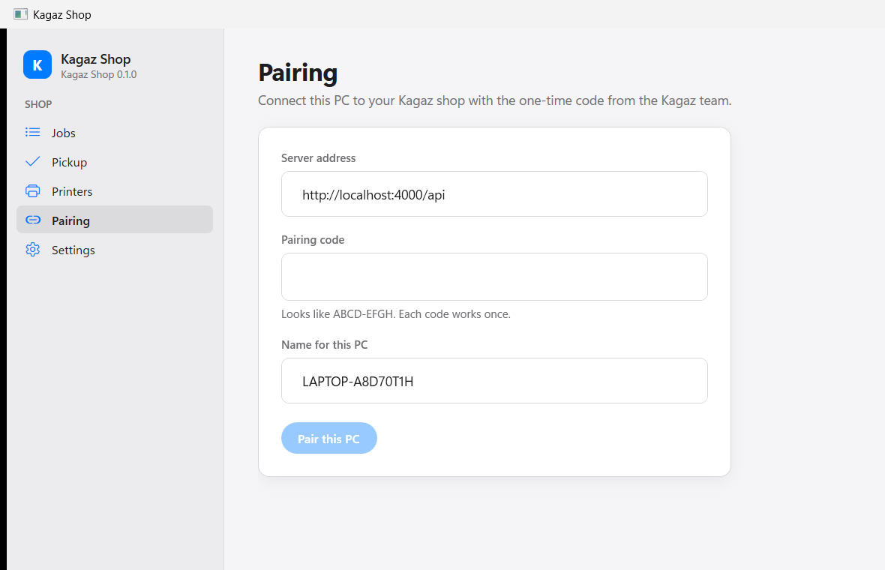
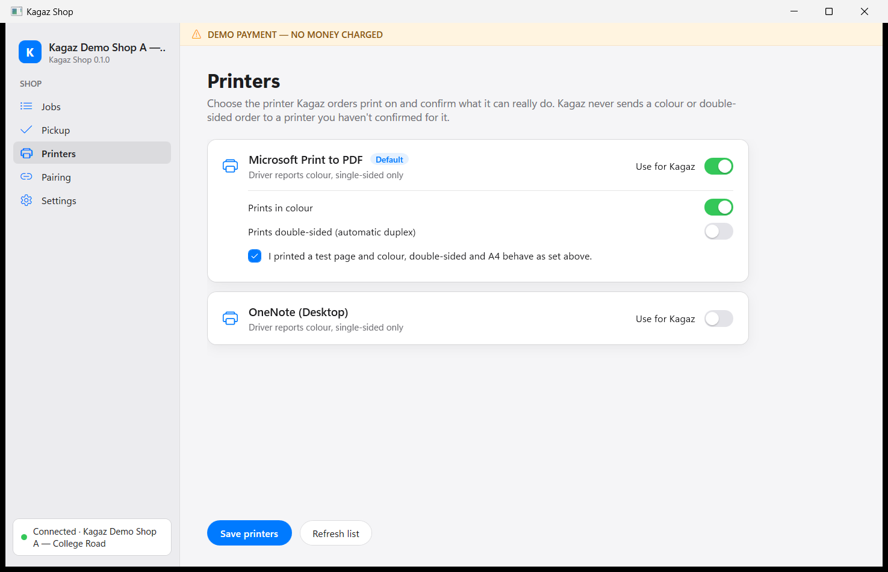
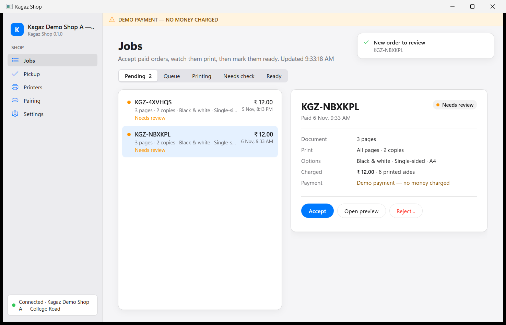

# Operator guide — Kagaz Shop (Windows app)

For the shopkeeper and counter staff. Kagaz Shop runs on the shop's Windows PC, receives paid
orders, prints each one as **one packet** (customer pages + one pickup slip) and tells the customer
when it is ready.

> This guide describes the behaviour decided in
> [ADR-002](../decisions/ADR-002-daily-pickup-number.md): daily pickup numbers (**#7 · 7 Nov**),
> printing finished = ready, no Mark Ready and no code check at pickup, and the Auto/Manual choice
> in **Settings**. Some screenshots below were taken before ADR-002 and still show the older
> Mark Ready and 8-character code screens.

## 1. Install and pair the PC

Follow [SHOP_AGENT_INSTALL.md](SHOP_AGENT_INSTALL.md) to install the app. Then:

1. Get a **pairing code** from the Kagaz team (admin: Shops → your shop → Devices → **Generate
   pairing code**). It works once and expires after 30 minutes.
2. In Kagaz Shop, **Pairing** screen:
   - **Server address** — given by the Kagaz team, e.g. `https://api.example.com/api`.
   - **Pairing code** — the code you were given (dashes don't matter).
   - **Name for this PC** — e.g. _Counter PC_.
3. Click **Pair this PC**. The app shows your shop's name and goes to **Jobs**.

The PC stays paired after restarts and updates. The device key is stored encrypted for this
Windows user. If the app ever says _"An administrator revoked this PC's access"_, ask the Kagaz team
for a new code and pair again.

Optional: **Settings → Start with Windows** so the app opens when you log in to the PC.

## 2. Sign in as operator

1. Open the operator sign-in (the app asks when nobody is signed in).
2. Enter your **Email or phone** and **Password** (given by the Kagaz team or your shop owner).
3. Click **Sign in**.

- You must be signed in to accept, reject, resolve checks and change settings.
- **Printing of accepted jobs continues while signed out.** Auto mode keeps working too.
- The session ends when you click **Sign out** or close the app. Sign out when you leave the
  counter.

## 3. Set up the printer (do this once, and after changing printers)

Open **Printers**. The list shows printers installed in Windows on this PC.

1. Make sure the printer is on, connected, loaded with **A4** paper, and prints a Windows test page.
2. Tick **Use for Kagaz** on the printer you want.
3. Set what it can **really** do:
   - **Prints in colour** — only if it has colour ink/toner and you want colour orders.
   - **Prints double-sided (automatic duplex)** — **only** if the printer flips the paper by
     itself.
4. Click **Make default printer** if you use more than one.
5. Print a test page from Windows (one colour page and one double-sided job if you ticked those).
   Then tick **"I printed a test page and colour, double-sided and A4 behave as set above."**
6. Click **Save printers**.

> **Warning — manual-duplex printers.** Many ink-tank printers (for example the **Canon G2010**)
> can only do "manual" double-sided: they print one side and ask you to turn the stack over. The
> Windows driver may still say it supports duplex. **Do not tick double-sided for these
> printers.** Kagaz would send a double-sided job and it would come out wrong. Customers then see
> "Double-sided not available here" for your shop, which is correct.

Kagaz never sends a colour or double-sided order to a printer you haven't confirmed for it. Auto
mode only works with a confirmed printer.

## 4. Auto or Manual approval

Go to **Settings → Approval** and choose:

| Mode       | What happens to a paid order                                                                  |
| ---------- | --------------------------------------------------------------------------------------------- |
| **Manual** | It waits in **Pending**. You look at it and click **Accept** (or **Reject**). Then it prints. |
| **Auto**   | It is accepted and printed straight away, as long as the safety checks below pass.            |

Auto still sends an order to **Pending** (for you to decide) when:

- the shop is closed, outside opening hours or in maintenance;
- the printer is not confirmed, is offline, or can't do the colour/double-sided the order asks for;
- the order is bigger than the shop's auto limits (pages, copies, printed sides) or the queue is
  too long.

**Pause auto** (switch next to the mode) stops auto-accepting at once, e.g. when paper is low or
you step away. New orders then wait in Pending. Turn it off to resume.

Changing the mode needs a signed-in operator and is recorded with your name.

## 5. The Jobs screen

A chime plays and a notice appears when a new order needs you. The list refreshes by itself; click
**Refresh** to force it. Tabs:

| Tab             | What is in it                                                                  | What you do                                                                                                           |
| --------------- | ------------------------------------------------------------------------------ | --------------------------------------------------------------------------------------------------------------------- |
| **Pending**     | Paid orders waiting for a decision (all orders in Manual; exceptions in Auto). | Select it, check pages, copies, colour, sides and amount. **Open preview** to see the PDF. **Accept** or **Reject…**. |
| **Queue**       | Accepted orders waiting for the printer.                                       | Nothing. They print one after another.                                                                                |
| **Printing**    | The order printing now.                                                        | Nothing. Watch the printer.                                                                                           |
| **Needs check** | A print that failed or whose result is unknown (see §7).                       | Check the tray, then resolve it.                                                                                      |
| **Ready**       | Printed orders waiting for the customer, with pickup number and date.          | Hand over when the customer comes.                                                                                    |

**Reject…** asks for a reason (file can't be read, content not allowed, printer unavailable,
option not supported, shop closing, out of paper or toner, other) and an optional note for the
customer. The order is cancelled and the customer is refunded automatically. Nothing is printed.

**Pause printing** (top of Jobs) stops the app starting new prints. Accepted jobs stay in the Queue
until you resume. Use it while you load paper or clear the printer.

When printing finishes without a printer error, the order moves to **Ready** by itself and the
customer is told. There is no Mark Ready button.

## 6. Handing over: find a packet by its pickup number

Every packet is **one print job**: the customer's pages (all copies) and **one pickup slip**. The
slip shows the number very large with the date, e.g. **#7 · 7 Nov**, plus the order reference
(`KGZ-…`), the shop name and a job summary like `3 pages × 2 copies · B/W · Double-sided`.

Packets print in order: #1, #2, #3 … each day.

**Face-up output tray** (most ink-tank printers, e.g. Canon G2010 — sheets land printed side up):

- The slip prints last, so it is the **top sheet of its packet**.
- The newest packet is on top of the pile. Going down the pile the numbers go down: #9, #8, #7 …
- To find **#7**: look for the slip with #7. Its pages are the sheets **under** it, down to the
  next slip (#6).

**Face-down output tray** (most laser printers): the slip is the **bottom** sheet of its packet,
and the pile is in the same number order. Its pages are the sheets **above** the slip, up to the
previous slip. When you lift the packet, turn it over so the slip is on top.

At the counter:

1. The customer says the number and shows **#N · date** on their phone. Check the **date is
   today**.
2. Take out the packet with that slip. Quickly check the summary on the slip matches the pages.
3. Hand over the stack with the slip on top. Nothing to type in the app.

**Today's pickups** (the Pickup page) lists today's ready orders by number, with reference and job
summary, so you can confirm a number before handing over. Customers may also take their own
packet from the tray if you allow it.

Keep unclaimed packets in a tray by date. Shred old slips and uncollected prints after the shop's
holding period.

## 7. Needs check and safe reprint

An order goes to **Needs check** when Kagaz can't be sure what was printed: printer error, jam or
paper out, the app or PC restarted mid-print, the printer stopped answering. **Kagaz never reprints
by itself** — that is how duplicate prints are avoided.

The screen shows: _"Check the printer output tray before reprinting — reprinting may produce
duplicate pages"_. First fix the printer, then look at the tray. Choose one:

| Button               | Use when                                                   | Result                                                                                                                                                                        |
| -------------------- | ---------------------------------------------------------- | ----------------------------------------------------------------------------------------------------------------------------------------------------------------------------- |
| **Confirm printed…** | Every page **and** the slip are in the tray.               | Tick _"I found every page and the pickup slip in the output tray"_ → order becomes Ready.                                                                                     |
| **Reprint…**         | Pages are missing or spoiled.                              | Step 1: tick _"I checked the output tray and this order did not print completely"_ → **Continue…**. Step 2: _"Print it again now?"_ → **Reprint now** (or **Don't reprint**). |
| **Mark failed…**     | The order can't be printed (printer broken, ink finished). | Order cancelled, customer refunded (demo: "Demo refund — no money moved").                                                                                                    |

Reprint rules:

- A reprint sends the **whole packet again** — every page, every copy and the slip. Remove any
  partial pages from the first try before handing over.
- The pickup number stays the same.
- Each reprint is recorded with your name. The second confirmation is your last chance to stop a
  duplicate.

## 8. Printer problems

| You see                                                                | Do this                                                                                                                                                                  |
| ---------------------------------------------------------------------- | ------------------------------------------------------------------------------------------------------------------------------------------------------------------------ |
| Printer is out of paper / jam / door open                              | Fix it on the printer. The order goes to Needs check; resolve as in §7.                                                                                                  |
| _"installed but not responding — check it is on, awake and connected"_ | Turn the printer on, wake it, reconnect the USB cable or Wi-Fi. Print a Windows test page. Then resolve the order in Needs check.                                        |
| Jobs stay in Queue                                                     | Is **Pause printing** on? Is the app Online? Is the printer ticked **Use for Kagaz** and confirmed? Is a colour/double-sided order waiting for a printer that can do it? |
| Colour or double-sided came out wrong                                  | Untick that capability in **Printers**, save, and tell the Kagaz team. Kagaz can't change the options of a paid order: mark it failed so the customer is refunded.       |
| Windows print queue has old jobs stuck                                 | Settings → Bluetooth & devices → Printers & scanners → your printer → **Open print queue**. Don't cancel a `KAGAZ-…` job that is printing; ask support first.            |
| HP printer installed with "Microsoft IPP Class Driver" never prints    | Install HP's full driver for the model (see [support runbook](../runbooks/SUPPORT_RUNBOOK.md#5-printer-unreachable)).                                                    |

## 9. Settings

- **Approval** — Auto / Manual and Pause auto (§4).
- **Start with Windows** — open the app at Windows login.
- **Connection** — server, shop, app version. Read these out to support.
- **Device token** — rotates automatically; **Rotate now** only if support asks.
- **Updates** — **Check for updates** / **Install update**. If the app shows **Update required**,
  install it; no new jobs print until you do. Updating while a job prints is safe.
- **Troubleshooting** — **Open logs folder** to send logs to support. Logs never contain tokens,
  pickup codes or download links.
- **Unpair this PC** — only when moving the app to another PC.

## 10. Daily routine

- Morning: printer on, A4 paper loaded, ink/toner OK, app **Online**, operator signed in, Auto or
  Manual as you want.
- During the day: watch **Pending** and **Needs check**. Keep the tray tidy so packets stay in
  number order.
- Closing: turn on **Pause auto** (or switch to Manual), let the Queue finish, sign out. Ask the
  Kagaz team to set the shop **Closed** if you won't open tomorrow.
